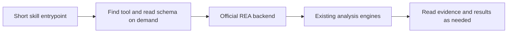

# REA Lite Skill

[中文](README.md) · English

**REA was using roughly 200k tokens before I could start. I wanted a lighter way in.**

Keep **207/207 original tool interfaces** accessible. Bring the estimated
**REA-related starting context down to about 2.4k tokens** using lazy discovery.
Analysis still runs on the official [REA 6.7.0](https://github.com/morluto/rea) backend.

## Why I made this

I like what REA can do. In my setup, though, registering it directly through MCP
meant a fresh conversation started with roughly 200k tokens of overhead. The
tool descriptions were taking up a large part of the context before I began
investigating the target.

I wanted to keep the tools and load their definitions only when I needed them.
The same idea applies to the manual: for an APK question, read the Android guide
first and leave unrelated platform details for later.

This project is that experiment: reuse MCP Compression Proxy's lazy mode,
shorten the skill entrypoint, then compare the actual schemas and call results.

## What the measurement shows

The baseline is **official REA 6.7.0**, not a ZCode rewrite. I started isolated
MCP processes, collected their catalogs and counted the same normalized
function-definition format using `o200k_base`:

| REA-related content | Official REA, direct exposure | REA Lite, lazy discovery |
|---|---:|---:|
| Model-facing tool definitions | 186,725 tokens | **1,171 tokens** |
| Loaded skill entrypoint | 5,071 tokens | **1,036 tokens** |
| This project's AGENTS trigger snippet | None | 200 tokens |
| **Combined comparison budget** | **191,796 (~192k)** | **2,407 (~2.4k)** |

**About 98.7% less REA-related context under this counting method.** Before the
skill is activated, the tool definitions themselves cost about **1.2k tokens**.
Selected schemas, reference guides and results add context later as they are read.

The original ~200k figure describes my setup. The table is a reproducible
comparison budget, not a fresh-chat UI reading or a promise about total chat
tokens. It excludes client system prompts, unrelated tools, messages and extra
framing. Clients serialize tools differently; a client that already uses lazy
discovery may see less benefit.

[Method and reproduction](docs/STARTUP.md) · [Measurement JSON](docs/startup-measurements.json)

## What is preserved, and what is not proven

**100% of the tool interfaces are accessible: 207/207. This is not a claim of
100% identical task performance.**

- The official backend and analysis engines are unchanged.
- All 207 input schemas were fetched through the gateway and matched the direct
  REA schemas exactly.
- Six official domain guides are retained byte-for-byte. Routing, provider notes
  and recipes are read on demand.
- One offline PE inspection returned identical complete Evidence on both paths.

I have not tested every real-engine workflow or established equal completion
quality across all tasks. Some specialized guidance from the original main
manual was condensed without a complete local copy. The gateway adds discovery
steps and another dependency. The agent must read relevant guides and page
results instead of treating a preview as the entire record. Host, provider and
authorization requirements still apply.

[Full review and limits](docs/REVIEW.md) · [Changes from upstream](docs/CHANGES.md)

## How it works

REA already supports reading domain guides on demand. This project makes the
entrypoint smaller and uses [MCP Compression Proxy](https://github.com/kdpa-llc/mcp-compression-proxy)
to discover tool definitions progressively. The client initially sees **9
gateway tools**, while all 207 REA tools remain behind them.

## Install

1. Use a compatible Node.js, `rea-agents@6.7.0` and `mcp-compression-proxy@1.3.3`.
2. Back up an existing skill, then copy all of `skills/reverse-engineer-anything/`
   into `~/.zcode/skills/`, keeping the name and reference files.
3. Merge [snippets/AGENTS.md](snippets/AGENTS.md) into `~/.zcode/AGENTS.md`.
4. Set **`toolExposure: "lazy"`**, configure the `rea` backend, and register only
   the gateway in this client. Disable its direct REA registration.
5. Reconnect and start a fresh conversation with an explicit target and question.

**Copying the skill alone does not configure lazy MCP.** See [SETUP.md](docs/SETUP.md)
for Windows/ZCode examples. Other skill-capable MCP clients need their own
configuration format and tool prefixes.

## Attribution and license

An **unofficial derivative of morluto/rea 6.7.0**. Not affiliated with or endorsed
by the upstream project. MIT, Copyright (c) 2026 morluto.

Tested with REA 6.7.0 and MCP Compression Proxy 1.3.3; re-check after upgrades.
The repository contains no private configuration, credentials, logs, payloads,
node_modules, analysis engines or npm packages. The complete wire-catalog
measurements in [REVIEW.md](docs/REVIEW.md) include output schemas and use a
different representation from the model-facing table above.

[LICENSE](LICENSE) · [NOTICE](NOTICE) · [CHANGELOG](CHANGELOG.md)
